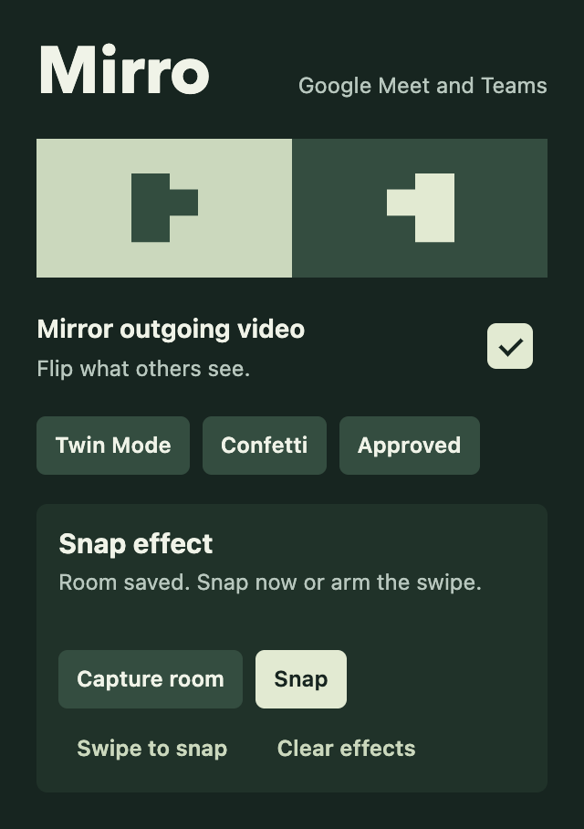

# Mirro

Mirror the camera video other people see in **Google Meet** and **Microsoft Teams on the web**. Mirro for Chrome also puts live effects on your feed, from a split-screen twin to a room reveal. The separate macOS app publishes a virtual camera named **Mirro** for desktop meeting apps.

**[Download the Chrome extension ZIP](https://github.com/RealBhupesh/Mirro/releases/latest/download/mirro-chrome-extension.zip)** · [Browse releases](https://github.com/RealBhupesh/Mirro/releases) · [Download the full source ZIP](https://github.com/RealBhupesh/Mirro/archive/refs/heads/main.zip)



## Install in Chrome

You’ll need **Chrome 111 or later**. The GitHub download installs as an unpacked extension.

1. Download and extract the [extension ZIP](https://github.com/RealBhupesh/Mirro/releases/latest/download/mirro-chrome-extension.zip). If you downloaded the full source instead, extract that ZIP and open its top-level folder.
2. Open `chrome://extensions`, enable **Developer mode**, and click **Load unpacked**.
3. Select the extracted `ChromeExtension` folder containing `manifest.json`. Keep that folder in place while Mirro is installed.
4. Open **Mirro** from Chrome’s Extensions menu. You can pin it to the toolbar for quick access.

To update, replace the contents of your existing `ChromeExtension` folder with the new release, then click **Reload** on Mirro’s card at `chrome://extensions`. Refresh any open Meet or Teams tabs so they pick up the update. [Chrome’s guide to loading unpacked extensions](https://developer.chrome.com/docs/extensions/get-started/tutorial/hello-world#load-unpacked).

## Use Mirro on a call

1. Open Google Meet or Teams in Chrome. For a Teams invite, choose **Continue on this browser** if prompted.
2. Select your usual camera in the meeting app and turn it on.
3. Open Mirro and enable **Mirror outgoing video**. Chrome remembers the setting between calls.
4. To check what others see, hold up a card with text and ask a second participant to read it. Meeting apps can mirror your local preview independently.

These frames show the same synthetic camera feed before and after Mirro flips it.

| Mirroring off | Mirroring on |
| --- | --- |
|  |  |

### Live effects

| Control | What others see |
| --- | --- |
| **Twin Mode** | One half of your feed reflected across the center. |
| **Confetti** | A brief burst of confetti over the live video. |
| **Approved** | An approval stamp over the live video. |
| **Snap** | A dust dissolve into a still image of your empty room. |

For **Snap**, keep the camera still, click **Capture room**, and step out of frame during the five-second countdown. When the room is saved, arm **Finger snap** and wait for hand tracking to start. Hold your hand near the camera, press your thumb against your middle finger for a moment, then snap. You can also click **Snap** or arm **Swipe to snap** and sweep your hand sideways across the upper half of the frame. **Return** resumes live video. **Clear effects** resets the effects and discards the room image.

Finger snap tracks your hand across video frames with [MediaPipe](ChromeExtension/vendor/mediapipe/README.md). Watch the popup for **Hand found**, then **Snap pose recognized**. You can snap with either hand, using your middle or ring finger. Mirro analyzes the camera frames locally while armed and uses no microphone input.

### Supported sites and privacy

The extension runs on [Google Meet](https://meet.google.com/) and Teams web at `teams.microsoft.com`, `teams.cloud.microsoft`, and `teams.live.com`. It processes frames in the meeting tab. The saved room image stays in that tab’s memory and is cleared when you reload or close it. Mirro stores your mirror preference in Chrome’s local extension storage. Your meeting app handles camera and microphone permissions, and Mirro leaves the audio track untouched.

## Native macOS app

The SwiftUI menu bar app supports **macOS 12.3 and later** and uses an Apple Core Media I/O camera extension. It’s available to build from source. GitHub Actions runs the Swift package tests and checks that the native app builds without signing. Signed activation, physical-camera behavior, and desktop meeting compatibility still need runtime verification. [View macOS checks](https://github.com/RealBhupesh/Mirro/actions/workflows/macos.yml).

<details>
<summary>Build and run the native app</summary>

1. Install Xcode and XcodeGen (`brew install xcodegen`).
2. In [project.yml](project.yml), set `DEVELOPMENT_TEAM` to an Apple Developer Program team with the System Extension capability and replace the three `com.example.Mirro*` bundle IDs. Keep the camera target key and embed dependency linked to the extension bundle ID through the YAML alias.
3. Configure the same App Group for the host and camera extension. The project uses `$(TeamIdentifierPrefix)$(MIRRO_APP_BUNDLE_ID)` for the group and uses it as the prefix for the extension’s Mach service name. Keep both entitlements and that service name aligned.
4. Run `xcodegen generate` and `swift test`. Open `Mirro.xcodeproj`, select the **Mirro** scheme, and build with signing enabled.
5. Copy the signed `Mirro.app` to `/Applications`, open it, and choose your physical camera from the menu bar. Click **Start virtual camera**, grant camera access, and approve the system extension when macOS prompts you.
6. Select **Mirro** in your meeting app’s camera picker. Use **Stop virtual camera** to release the physical camera. If you enable **Launch at login**, the app opens with capture stopped.

For an unsigned compile check with the default identifiers, run the commands used by the [macOS workflow](.github/workflows/macos.yml).

```sh
xcodegen generate
xcodebuild -project Mirro.xcodeproj -scheme Mirro -configuration Debug \
  -destination 'generic/platform=macOS' -derivedDataPath DerivedData \
  CODE_SIGNING_ALLOWED=NO CODE_SIGNING_REQUIRED=NO build
```

For signed testing, follow the `VERIFY-ON-MAC` notes in the native code. Check extension embedding and activation, camera discovery and switching, frame delivery through stop and restart, and launch at login on macOS 12 and later. [Apple’s Core Media I/O camera extension guide](https://developer.apple.com/documentation/coremediaio/creating-a-camera-extension-with-core-media-i-o).

</details>

## Repository layout

| Path | What it contains |
| --- | --- |
| [ChromeExtension](ChromeExtension) | Manifest V3 extension, popup, preference bridge, and video processing pipeline. |
| [App](App) | macOS menu bar controls, camera capture, and system extension activation. |
| [CameraExtension](CameraExtension) | Core Media I/O virtual camera and its frame relay. |
| [LoginItem](LoginItem) | Launch-at-login helper for macOS 12. |
| [Sources/MirrorCore](Sources/MirrorCore) · [Tests](Tests/MirrorCoreTests) | Shared Swift settings, format, timing, rendering, and unit tests. |

Mirro is released under the [MIT License](LICENSE). For bugs, report your Chrome or macOS version, meeting app, and steps to reproduce. [Open an issue](https://github.com/RealBhupesh/Mirro/issues/new).
